# AI-Assisted Property Operations Workbench

**English** | [简体中文](README.md)

A prototype web application for residential property staff to manage service requests, work plans, execution records and site inspections. Built with **Python, FastAPI, SQLite, Jinja2/JavaScript and Google Gemini**, it combines business record management, rule-based checks and AI-assisted review to help staff investigate reported issues and plan follow-up work.

*Portfolio demonstration using a fictional residential estate and synthetic records.*

## Example: reviewing a water-supply report

A resident in **Room 302** reports that the cold-water taps in the kitchen and bathroom have stopped running. Staff can open the report, review its original description and compare it with work records.

The system searches for potentially related reports and work plans. In this example, Gemini suggests reviewing a similar report from **Room 301** alongside the Room 302 issue, while examining a corridor water-flow report separately. Its assessment links back to the records used for each recommendation.

<p align="center">
  <a href="docs/images/room-302-ai-review.png">
    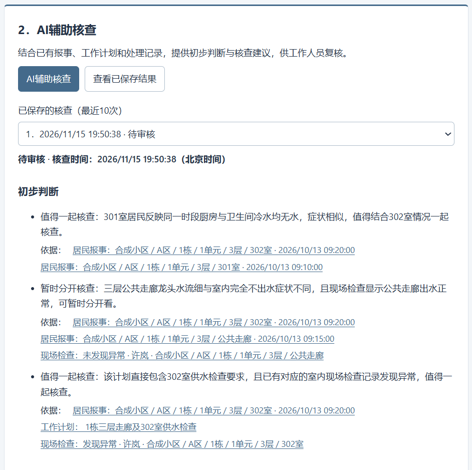
  </a>
  <br><sub>AI-assisted assessment of Room 302 with source references · Click to view full size</sub>
</p>

The same work plan covers Room 302 and the third-floor corridor, but the saved records differ by location. A separate, **rule-based** check finds an execution record for the corridor and a site inspection for Room 302, with no execution record explicitly assigned to Room 302 in the current query. Staff can inspect the original records before deciding what to verify on site.

<p align="center">
  <a href="docs/images/plan-evidence-coverage.png">
    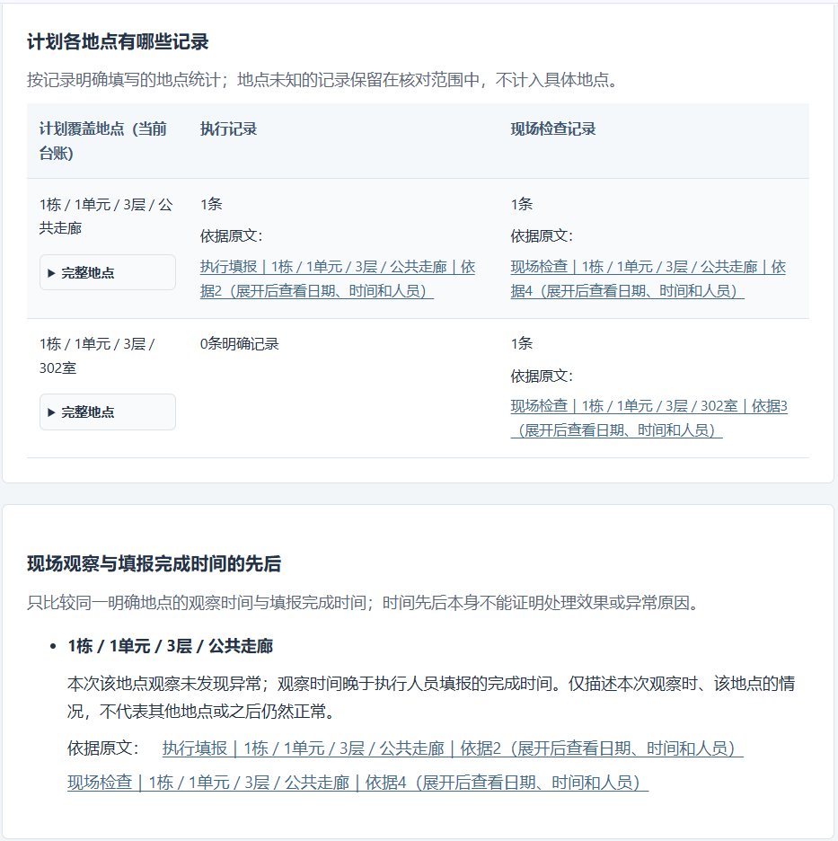
  </a>
  <br><sub>Rule-based comparison of execution and inspection records · Click to view full size</sub>
</p>

## System architecture

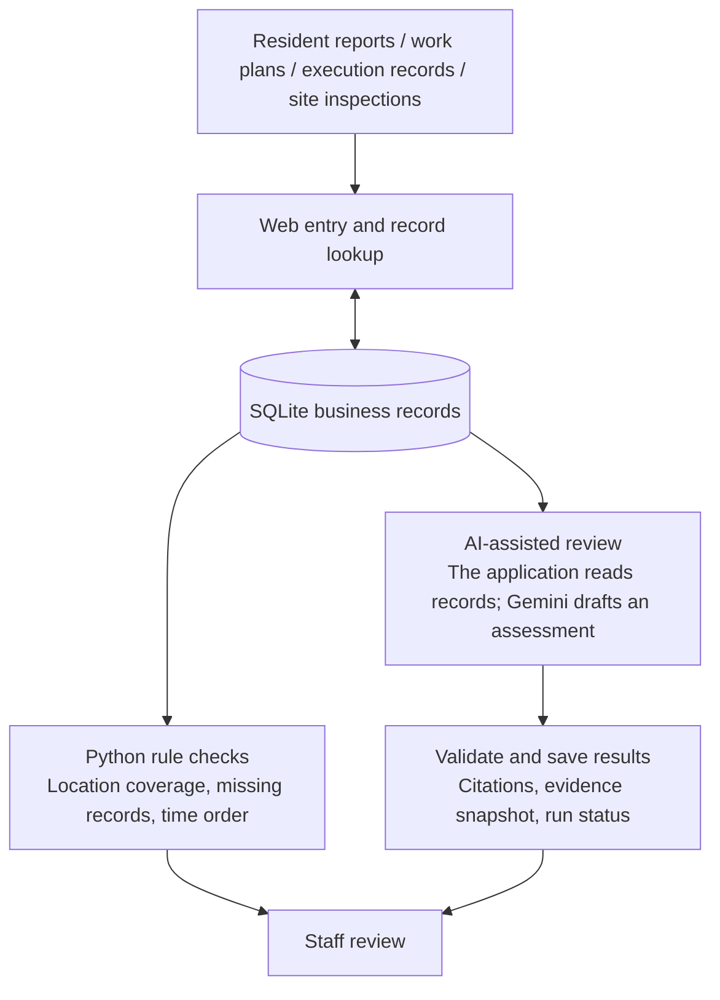

Both review paths use the same business records but run separately. **Plan record checks** use Python to compare locations, record coverage and timestamps. For **AI-assisted review**, the application collects evidence first, then asks Gemini for a structured assessment. The validated result is saved for staff to review alongside its source records.

## Technical implementation

- **Web application and data model:** FastAPI endpoints and Jinja2/JavaScript pages support report, plan, execution and inspection entry, lists and details. SQLAlchemy manages the SQLite data model; Alembic tracks schema migrations. Submission IDs allow safe retries without duplicating saved records.
- **Record discovery and rule checks:** Python searches related reports and candidate plans using service category, location and bounded time windows. It separately checks each plan's execution and inspection records, preserving unknown locations and observation times. Staff can also add or revoke plan links without changing the original records.
- **Gemini-assisted assessment:** The application gathers evidence first, then makes a structured Gemini request. The response identifies facts, candidate relationships, uncertainties and suggested follow-up checks. Pydantic validates the output structure; application checks reject unknown citation keys or missing candidate assessments.
- **Traceability:** Saved runs retain the evidence snapshot, citations, output and status. Staff can reopen earlier results and inspect source records; adding new records does not change an older snapshot. Failed runs retain their stage and error category for diagnosis.

<details>
<summary>More interface screenshots (click to view full size)</summary>

<table>
<tr>
  <td align="center" width="50%" valign="top">
    <strong>Service request list</strong><br>
    <a href="docs/images/service-request-list.png">
      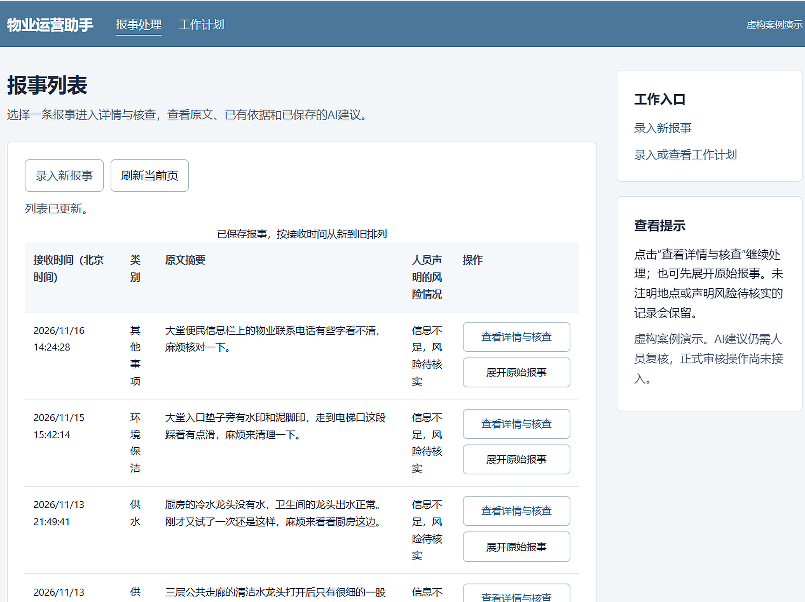
    </a>
  </td>
  <td align="center" width="50%" valign="top">
    <strong>Work plan list</strong><br>
    <a href="docs/images/work-plan-list.png">
      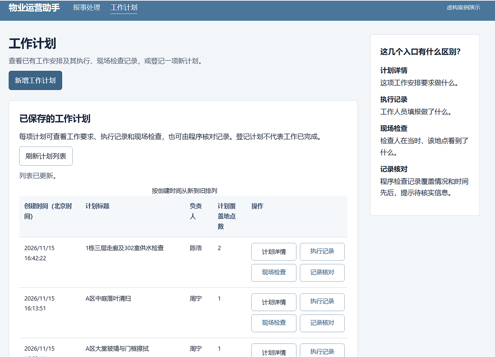
    </a>
  </td>
</tr>
<tr>
  <td align="center" width="50%" valign="top">
    <strong>Room 302 report details</strong><br>
    <a href="docs/images/room-302-report-detail.png">
      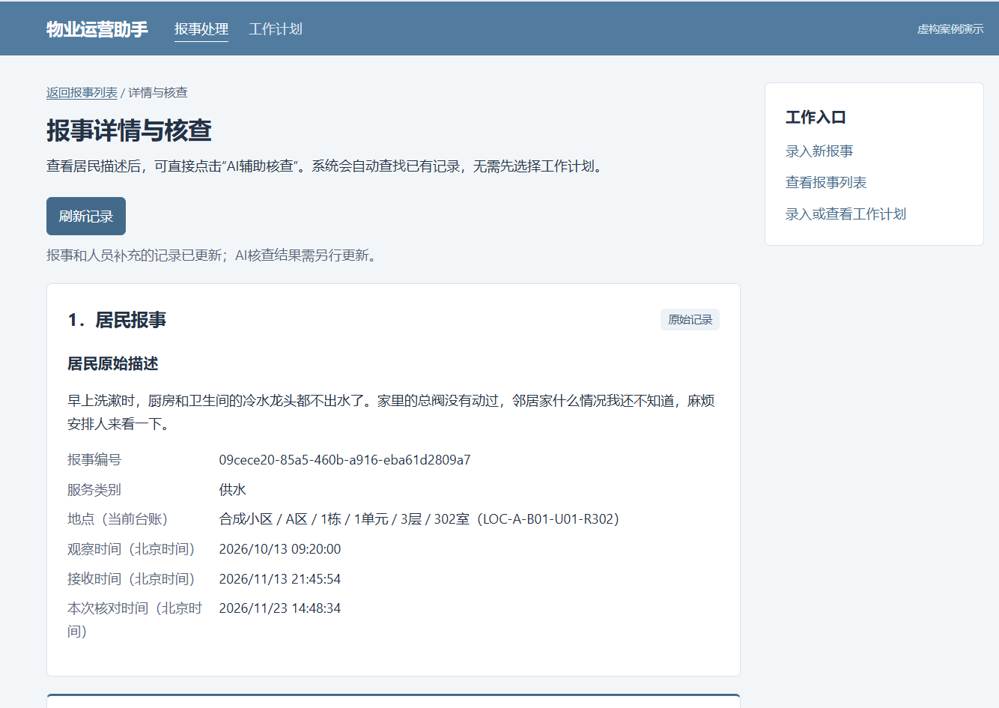
    </a>
  </td>
  <td align="center" width="50%" valign="top">
    <strong>Execution records</strong><br>
    <a href="docs/images/work-execution-record.png">
      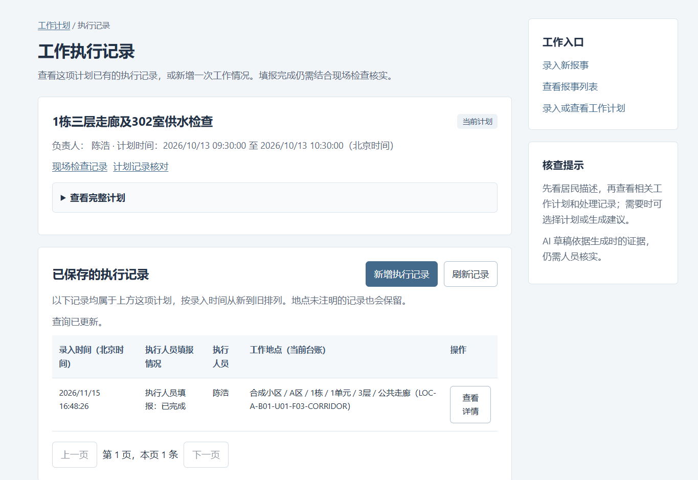
    </a>
  </td>
</tr>
<tr>
  <td align="center" width="50%" valign="top">
    <strong>Site inspection records</strong><br>
    <a href="docs/images/site-inspection-record.png">
      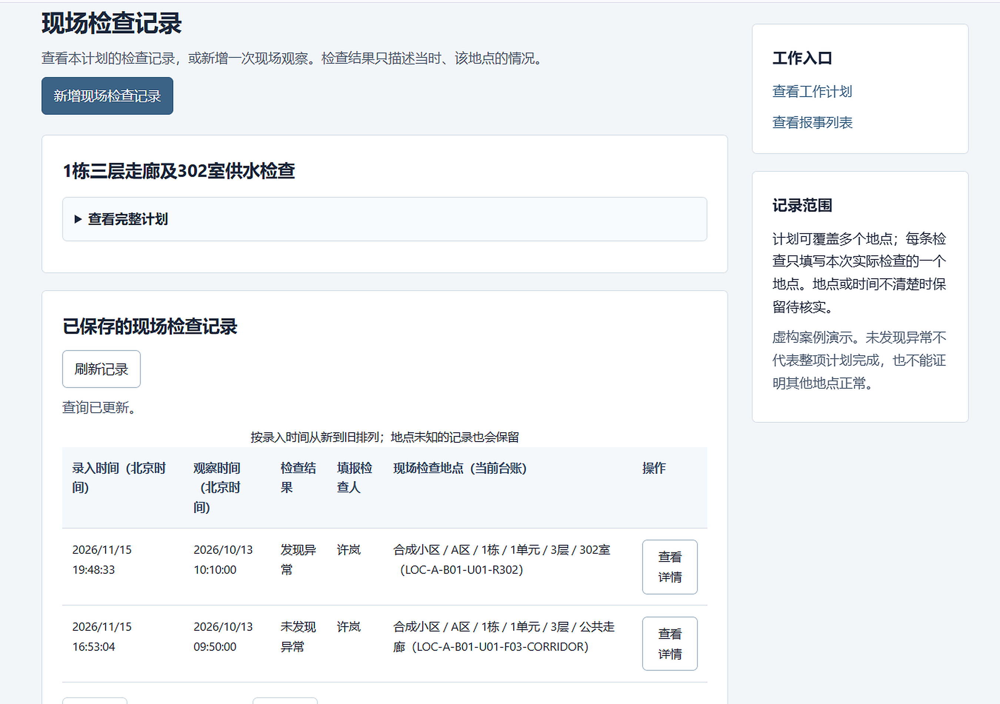
    </a>
  </td>
  <td align="center" width="50%" valign="top">
    <strong>AI follow-up recommendations</strong><br>
    <a href="docs/images/room-302-ai-follow-up.png">
      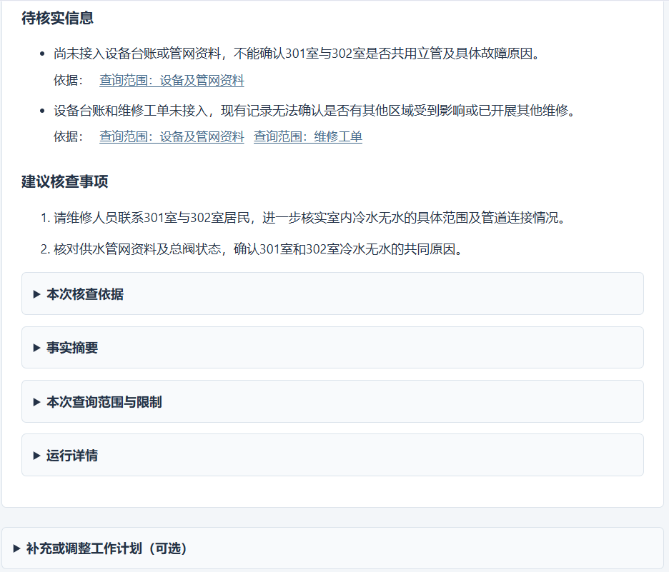
    </a>
  </td>
</tr>
<tr>
  <td align="center" width="50%" valign="top">
    <strong>Rule-check findings</strong><br>
    <a href="docs/images/plan-evidence-findings.png">
      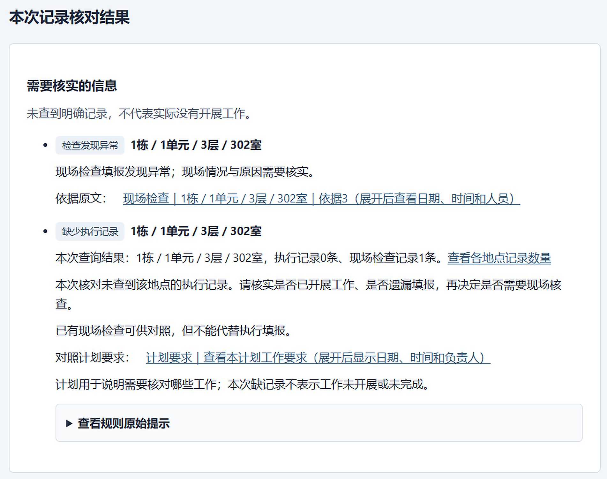
    </a>
  </td>
  <td align="center" width="50%" valign="top">
    <strong>Source records and versions</strong><br>
    <a href="docs/images/plan-evidence-sources.png">
      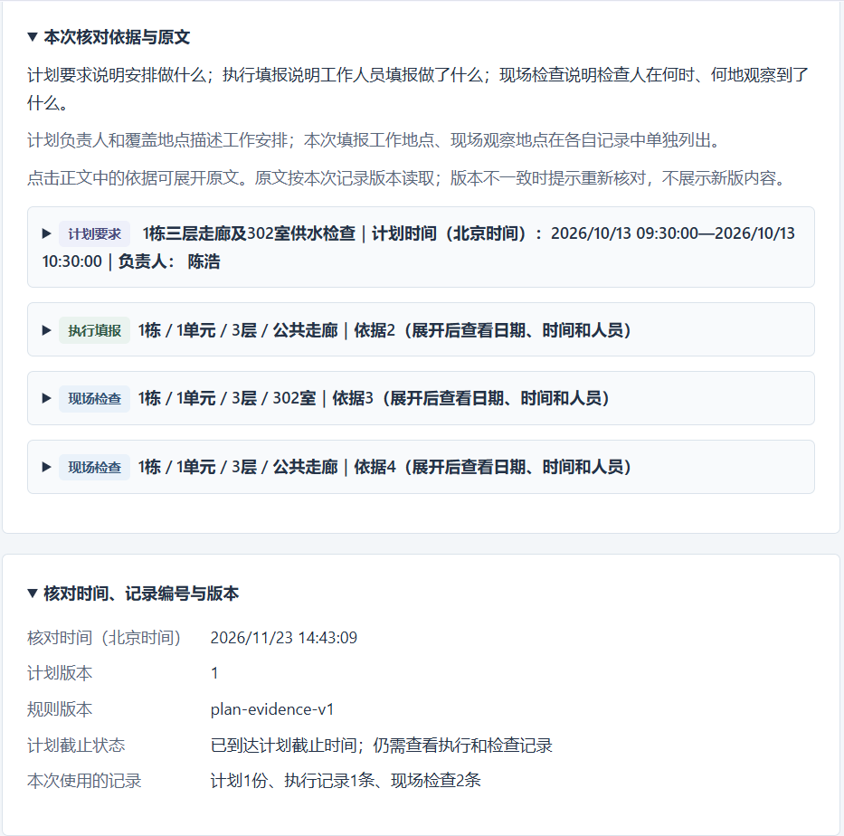
    </a>
  </td>
</tr>
</table>

</details>

## Testing and current scope

The project includes Python tests for APIs, data validation, transactions, migrations and evidence checks, plus JavaScript interaction tests. The [validation summary](docs/validation-status-20261116.md) records **456 passing Python test methods in an isolated copy** as of 16 November 2026. On 17 November 2026, [GitHub Actions passed on Windows and Ubuntu](https://github.com/yushi916/AI-Assisted-Property-Operations-Workbench/actions/runs/44031522112) for the `main` branch.

[Targeted model evaluations](docs/validation-status-20261116.md) also cover water-supply and cleaning scenarios. Four recorded model outputs passed structural validation, while content review identified citation gaps and descriptions that sometimes exceeded the source evidence. These cases are retained for review rather than presented as a general accuracy score.

This is a local prototype using synthetic records. The web interface supports reviewing saved AI suggestions and adding or revoking plan links; a formal approval and correction workflow is still a future step. Equipment registries, maintenance work orders and notices are not yet connected to the evidence search.

<details>
<summary>Local setup and testing</summary>

Use **Python 3.12** and a fresh local database. From the repository root:

```bash
python -m pip install -r requirements-dev.txt
python -m alembic upgrade head
python seed_demo_location_hierarchy.py
python seed_demo_floor_locations.py
python -m uvicorn main:app --host 127.0.0.1 --port 8000
```

Open **http://127.0.0.1:8000/reports** for service requests, **http://127.0.0.1:8000/plans** for work plans, or **http://127.0.0.1:8000/docs** for the API documentation. The seed scripts create the sample location hierarchy; enter reports and other business records through the UI to try the workflows. The screenshots show separately prepared synthetic records.

AI-assisted review requires a Gemini API key in the `GEMINI_API_KEY` environment variable; `GEMINI_MODEL` may be set to a supported model. Record management and Python rule checks can run without an API key. The application reads credentials from the process environment, not automatically from a `.env` file.

To run regression tests:

```bash
python -m unittest discover -s tests -v
node --test tests/test_execution_form.cjs tests/test_execution_navigation.cjs tests/test_inspection_form.cjs tests/test_plan_evidence_view.cjs tests/test_report_evidence_view.cjs tests/test_report_location_picker.cjs tests/test_agent_run_view.cjs tests/test_plan_navigation.cjs
```

JavaScript tests use Node.js 24. For an existing database, follow the [database migration guide](docs/database-migrations.md) rather than treating it as a new installation.

Further evidence: [plan record checks](docs/plan-evidence-validation.md) · [manual report–plan links](docs/report-plan-links-validation.md) · [validation results and limits](docs/validation-status-20261116.md).

</details>
