# AI 辅助物业运营工作台（AI-Assisted Property Operations Workbench）

[English](README.en.md) | **简体中文**

这是一个面向住宅物业工作人员的 Web 应用原型，支持居民报事、工作计划、执行记录和现场检查的录入与查询。项目使用 **Python、FastAPI、SQLite、Jinja2/JavaScript 和 Google Gemini**，将日常业务记录管理、程序规则核对和 AI 辅助分析结合起来，帮助工作人员查找相关记录、梳理待核实问题并确定后续核查事项。

*个人作品集项目，使用虚构小区和合成业务数据演示。*

## 使用示例：302 室供水报事

302 室居民反映，厨房和卫生间的冷水龙头都不出水。工作人员可以在网页中查看报事原文、地点和时间，再查阅相关的工作计划及处理记录。

系统根据已有记录查找相关报事和候选计划。在这个案例中，Gemini 建议将 **301 室**类似的供水问题与 302 室一起核查；三层公共走廊的水流情况则建议暂时分开查看。每项初步判断都附有原始记录链接，方便工作人员核对。

<p align="center">
  <a href="docs/images/room-302-ai-review.png">
    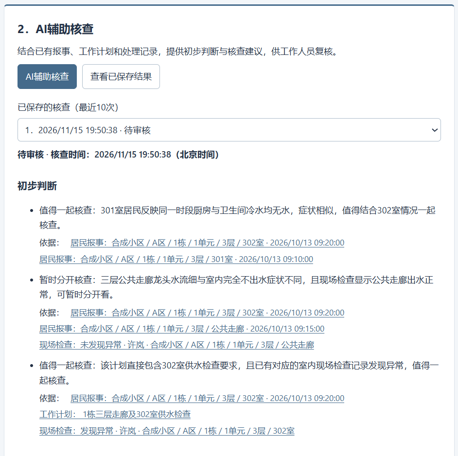
  </a>
  <br><sub>302 室供水报事：AI 初步判断与依据 · 点击查看高清原图</sub>
</p>

相关供水检查计划同时覆盖 **302 室和三层公共走廊**，但两处保存的执行、检查记录并不相同。**独立的程序规则核对**显示：公共走廊有明确的执行记录，302 室有现场检查记录；本次查询未找到明确对应 302 室的执行记录。工作人员可以进一步查看原文，确认实际开展了哪些工作。

<p align="center">
  <a href="docs/images/plan-evidence-coverage.png">
    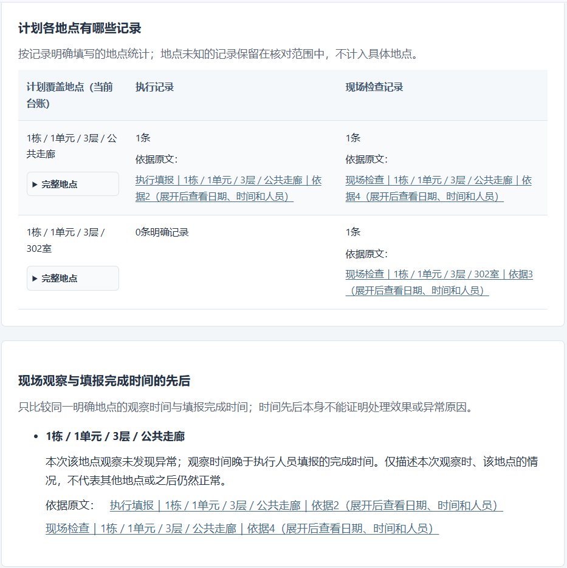
  </a>
  <br><sub>按地点核对执行与现场检查记录 · 点击查看高清原图</sub>
</p>

## 系统设计

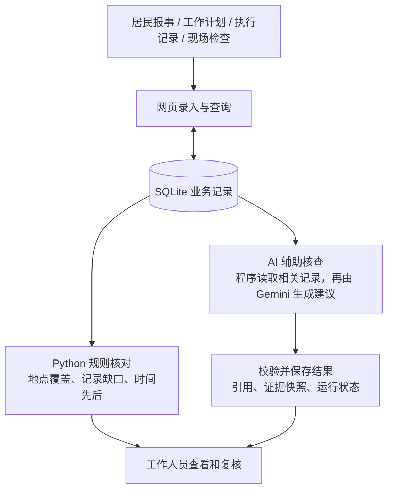

两种核查使用同一套业务记录，但各自独立：**计划记录核对**由 Python 程序检查地点、记录覆盖情况和时间先后；**AI 辅助核查**由程序读取并整理相关证据，再交给 Gemini 生成建议。AI 结果经过校验后保存，供工作人员查看原始依据和历史记录。

## 技术实现

- **业务网页与数据管理：** 使用 FastAPI 提供接口，Jinja2 和 JavaScript 实现录入、列表及详情页面。SQLAlchemy 管理 SQLite 数据，Alembic 管理数据库迁移。使用提交编号保护重复提交，避免因刷新或重试产生重复记录。
- **候选查找与规则核对：** Python 根据服务类别、地点及限定的时间范围查找相关报事和计划，逐项读取执行及现场检查记录。地点或观察时间不明确时保留未知状态。工作人员还可以补充或撤销报事与计划的关联，关联历史不会覆盖原业务记录。
- **Gemini 辅助核查：** 程序先只读获取业务材料，再调用 Gemini 生成事实摘要、候选判断、待核实信息和后续建议。Pydantic 检查输出结构，应用程序进一步检查引用编号是否有效、候选是否完整覆盖。
- **结果与依据保存：** 每次运行保存证据快照、引用、核查结果和状态，支持查看历史结果。后续新增业务记录也不会改变此前保存的证据快照。失败运行会记录发生阶段和错误类别，方便定位问题。

<details>
<summary>更多页面截图（点击图片查看高清原图）</summary>

<table>
<tr>
  <td align="center" width="50%" valign="top">
    <strong>居民报事列表</strong><br>
    <a href="docs/images/service-request-list.png">
      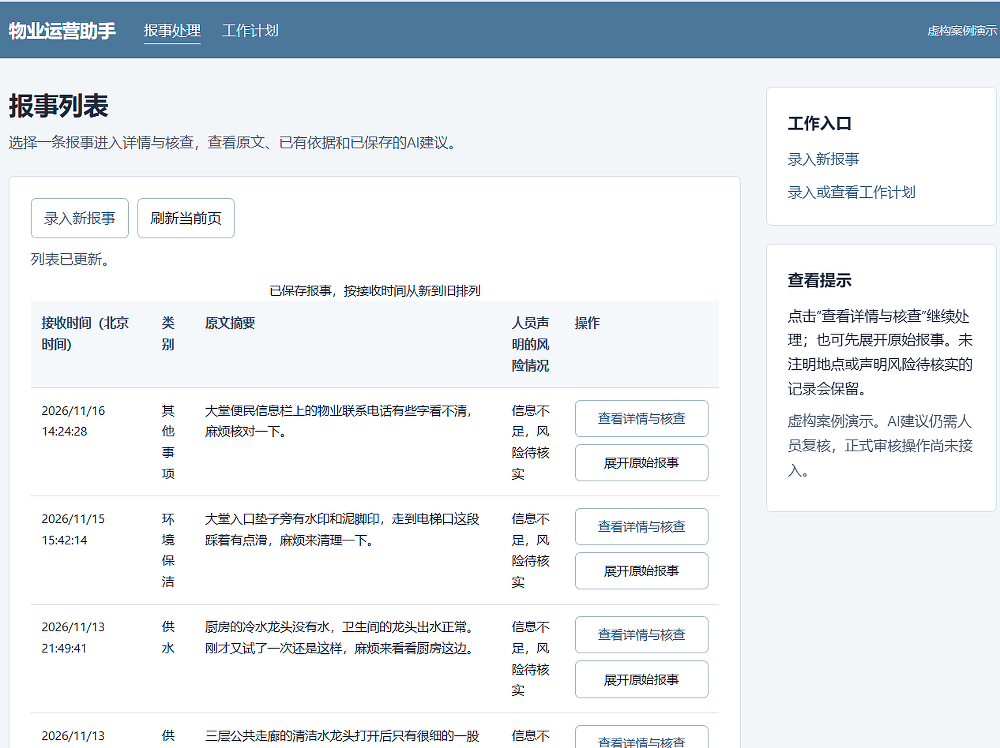
    </a>
  </td>
  <td align="center" width="50%" valign="top">
    <strong>工作计划列表</strong><br>
    <a href="docs/images/work-plan-list.png">
      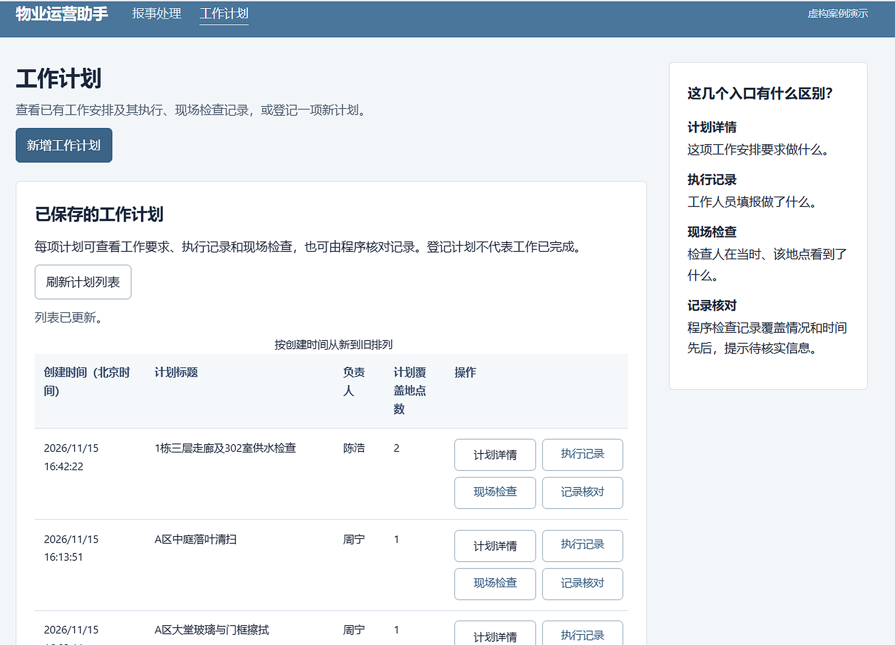
    </a>
  </td>
</tr>
<tr>
  <td align="center" width="50%" valign="top">
    <strong>302 室报事详情</strong><br>
    <a href="docs/images/room-302-report-detail.png">
      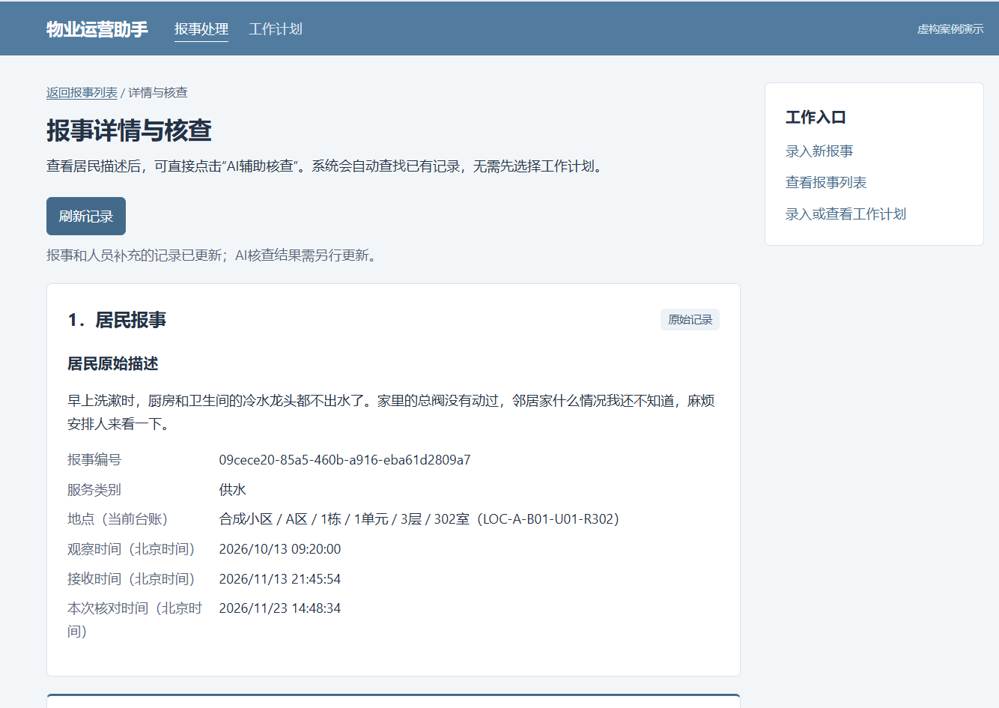
    </a>
  </td>
  <td align="center" width="50%" valign="top">
    <strong>工作执行记录</strong><br>
    <a href="docs/images/work-execution-record.png">
      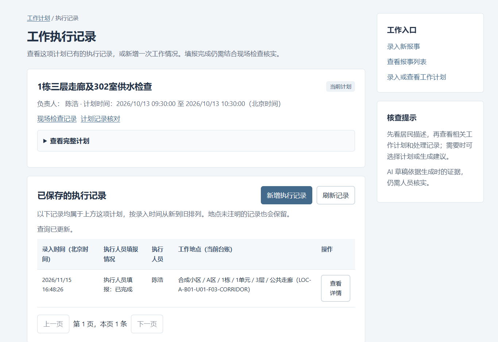
    </a>
  </td>
</tr>
<tr>
  <td align="center" width="50%" valign="top">
    <strong>现场检查记录</strong><br>
    <a href="docs/images/site-inspection-record.png">
      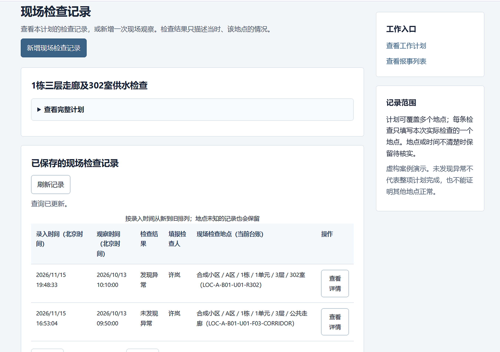
    </a>
  </td>
  <td align="center" width="50%" valign="top">
    <strong>AI 待核实信息及建议</strong><br>
    <a href="docs/images/room-302-ai-follow-up.png">
      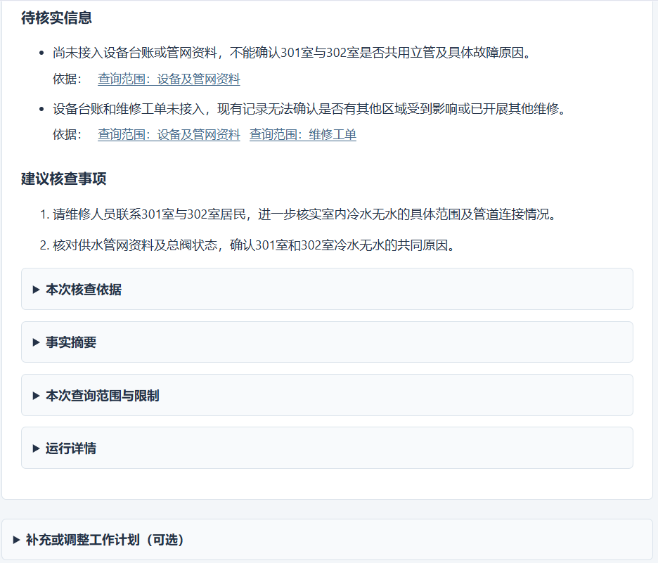
    </a>
  </td>
</tr>
<tr>
  <td align="center" width="50%" valign="top">
    <strong>规则核对的问题提示</strong><br>
    <a href="docs/images/plan-evidence-findings.png">
      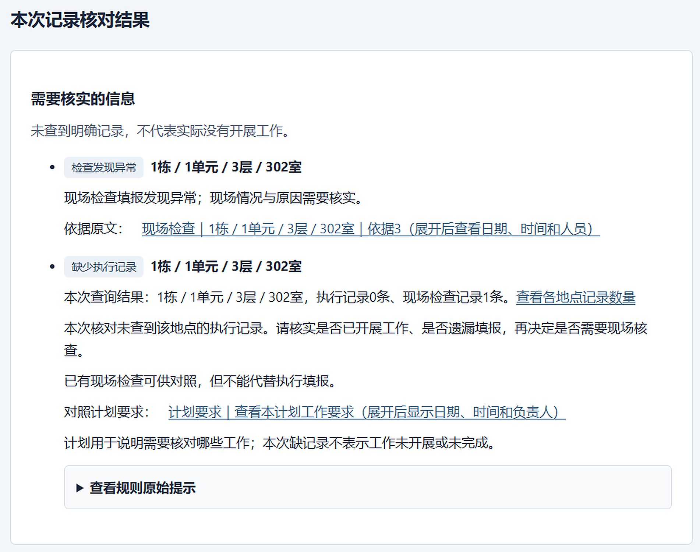
    </a>
  </td>
  <td align="center" width="50%" valign="top">
    <strong>核对依据与记录版本</strong><br>
    <a href="docs/images/plan-evidence-sources.png">
      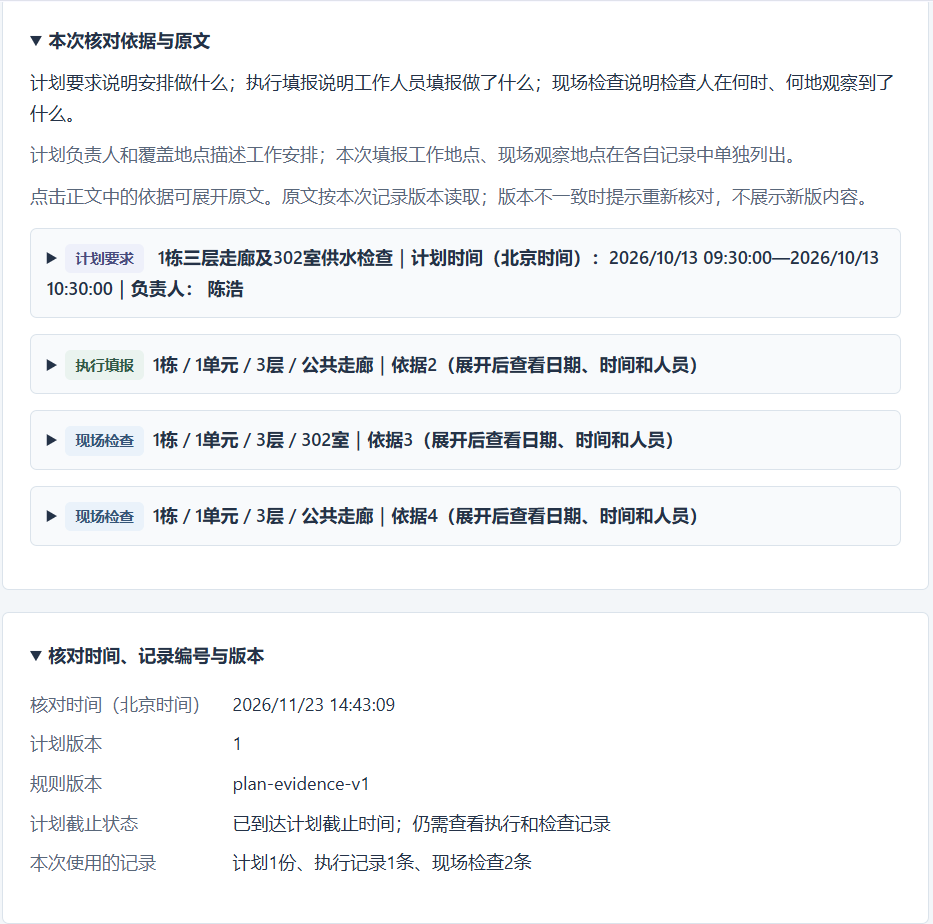
    </a>
  </td>
</tr>
</table>

</details>

## 测试与项目范围

仓库提供了 API、数据库事务、输入校验、迁移和证据核对等 Python 回归测试，以及网页交互的 JavaScript 测试。[验证汇总](docs/validation-status-20261116.md)记录了 **2026 年 11 月 16 日隔离副本中 456 项 Python 测试方法通过**。2026 年 11 月 17 日，`main` 分支的 [GitHub Actions 在 Windows 和 Ubuntu 上均运行成功](https://github.com/yushi916/AI-Assisted-Property-Operations-Workbench/actions/runs/44031522112)。

项目也保留了供水和保洁场景的[有限真实模型评估](docs/validation-status-20261116.md)。其中四次生成的输出结构均通过校验，但内容复核发现了引用不足、部分表述超出原始证据范围等问题。这些结果用于记录实际问题和后续改进方向，不作为整体准确率。

目前是使用合成数据的本地原型。网页支持查看已保存的 AI 建议，以及补充、撤销报事与计划的关联；尚未实现正式审核、保存人工修正建议等功能。设备台账、维修工单和通知等数据源也尚未接入自动取证。

<details>
<summary>本地运行与测试</summary>

使用 **Python 3.12**。对于全新数据库，在项目根目录执行：

```bash
python -m pip install -r requirements-dev.txt
python -m alembic upgrade head
python seed_demo_location_hierarchy.py
python seed_demo_floor_locations.py
python -m uvicorn main:app --host 127.0.0.1 --port 8000
```

打开 **http://127.0.0.1:8000/reports** 查看报事列表，**http://127.0.0.1:8000/plans** 查看工作计划，或打开 **http://127.0.0.1:8000/docs** 查看 API 文档。初始化脚本只建立示例地点台账；可以通过网页录入报事及其他业务记录。截图使用的是此前单独准备的合成记录。

使用 AI 核查时，需要在启动服务的环境中配置 `GEMINI_API_KEY`，也可以通过 `GEMINI_MODEL` 指定可用模型。普通业务录入和程序规则核对不需要模型密钥。程序从环境变量读取配置，不会自动加载 `.env` 文件。

运行回归测试：

```bash
python -m unittest discover -s tests -v
node --test tests/test_execution_form.cjs tests/test_execution_navigation.cjs tests/test_inspection_form.cjs tests/test_plan_evidence_view.cjs tests/test_report_evidence_view.cjs tests/test_report_location_picker.cjs tests/test_agent_run_view.cjs tests/test_plan_navigation.cjs
```

JavaScript 测试使用 Node.js 24。已有数据库的升级步骤请参阅[数据库迁移说明](docs/database-migrations.md)。

进一步查看：[计划记录核对验收](docs/plan-evidence-validation.md) · [报事与计划关联验收](docs/report-plan-links-validation.md) · [验证结果与限制](docs/validation-status-20261116.md)。

</details>
